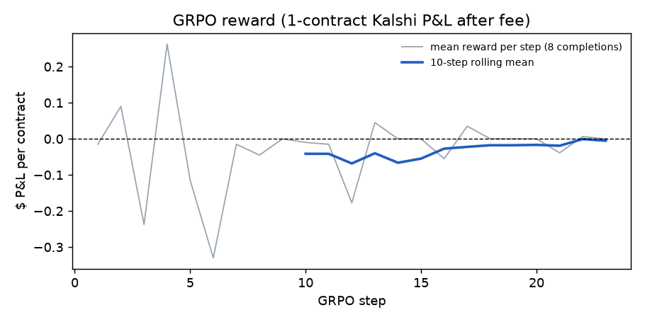

# GRPO for "Should I bet on this?" (NFL Kalshi game markets)

## What we did (plain language)

- **Task.** We show a small language model a real live NFL moment and the real Kalshi price for the home team to win, 20 seconds after a play.
  The model must answer one word: BUY_HOME, BUY_AWAY or PASS.
- **Reward.** The reward is the real profit of one contract, settled on the real final score.
  Buying costs the price plus 1 cent (spread), plus Kalshi's fee: ceil(0.07 x P x (1-P) x 100) cents for one contract at paid price P.
  PASS earns 0. An invalid answer costs 5 cents.
- **GRPO** (Group Relative Policy Optimization) is a reinforcement-learning method.
  For each prompt the model samples 8 answers; answers that made more money than the group average are made more likely, and the rest less likely.
  There is no answer key, only the money.
- **Model.** Qwen2.5-0.5B-Instruct with a LoRA adapter (a small set of trainable weights on top of the frozen model), TRL GRPOTrainer, Apple MPS, learning rate 1e-5, 8 generations per prompt, at most 6 answer tokens.
- **Data.** Train = 2025 season windows (13,089 prompts, 281 games). Test = 2026 windows (2,634 prompts, 66 games). Winners come from the ESPN game summaries. Nothing is simulated.
- **Blind set.** 150 random 2026 test prompts are in `/tmp/betbench/prompts.csv`; the answer key is `train/grpo/betbench_key.json`.

## Results on the full 2026 test set (2,634 prompts, 66 games)

P&L is dollars per $1 contract. CI = 95% bootstrap interval that resamples whole games (plays inside one game are not independent).

| Policy | # bets | Win rate of bets | P&L per bet | Total P&L | P&L/bet 95% CI (game-clustered) |
|---|---|---|---|---|---|
| Always PASS | 0 | n/a | $0.000 | $0.00 | n/a |
| Always buy the favorite | 2,634 | 70.5% | -$0.031 | -$80.36 | [-$0.092, +$0.031] |
| Follow the last price jump | 2,324 | 54.5% | -$0.033 | -$77.58 | [-$0.048, -$0.018] |
| Supervised view (market calibrated, so PASS) | 0 | n/a | $0.000 | $0.00 | n/a |
| Qwen2.5-0.5B-Instruct, base (no RL; Kaggle T4, greedy) | 2,634 | 48.9% | -$0.025 | -$65.59 | [-$0.113, +$0.064] |
| Qwen + GRPO (Kaggle T4, 10 min) | running: kernel v2 | | | | |

On the 150-prompt blind subset: buy-the-favorite = 150 bets, 72.0% win rate, -$0.023/bet (CI -$0.102 to +$0.054); follow-the-jump = 128 bets, 54.7%, -$0.048/bet (CI -$0.119 to +$0.020).

Base Qwen on the 150 blind prompts: 150 bets, 56.0% win rate, +$0.062/bet, +$9.29 total (CI -$0.035 to +$0.159). The same model loses money on the full set, so this is luck from a small sample. It never passes and buys the away team 78% of the time.

Blind Claude baseline on the same 150 prompts (answered without the key, file `claude_betbench.json`): 12 bets, 7 wins (58%), +$0.92 total (+$0.077 per bet).
That is only 12 bets, so it is not evidence of a real edge; one or two different outcomes would flip the sign.

**Mac run status.** The Mac has 8 GB of memory, so GRPO ran at about 10 seconds per step and only reached 23 steps (1 prompt x 8 answers per step) before it was stopped to free the Mac for the live demo.
No checkpoint was saved, so the GRPO model was not evaluated on the Mac.
The full run (64 answers per step for 10 minutes on a Tesla T4, then the GRPO evaluation) is running on Kaggle: https://www.kaggle.com/code/faisalnabulsi/kk-grpo (code in `kaggle/kk_grpo.py`).
Version 1 ran the base-model evaluation above and then crashed on import, because Kaggle ships torchao 0.10. Version 2 uninstalls torchao and trains.

## Reward curve

The 23-step Mac run: mean reward over the first 10 steps was -$0.042 per answer; over the last 10 steps it was -$0.005.
In 7 of the last 10 steps all 8 sampled answers earned exactly the same reward (TRL's `frac_reward_zero_std` = 1), and the average answer length fell to 2 tokens, the length of "PASS".
W&B run: https://wandb.ai/faisal_nabulsi-berkeley2025/kalshi-knows/runs/qmb4qvdh (project kalshi-knows, group grpo).

## Did GRPO learn anything beyond PASS?

Not in the Mac run.
The reward moved toward zero because the model learned to say PASS more often.
That is the right lesson for a calibrated market, but it is the same thing the "always PASS" baseline already does.
23 steps is far too few to tell whether the model could find real mispricing.

## Why PASS is the right answer most of the time

Our earlier supervised work found the Kalshi game price is calibrated: a 70-cent team wins about 70% of the time.
If the price is already the true probability, every bet loses the spread plus the fee on average.
So the best policy is PASS unless the model can spot real mispricing, which these baselines show is hard: "buy the favorite" wins 70% of its bets and still loses money.

## Honest one-line conclusion

Every simple betting rule loses money after the 1-cent spread and the fee, and the first GRPO steps learned what the baselines already show: in a calibrated Kalshi market, the profitable move is to PASS.

## Files

- `data.py`: builds prompts, reward, Kalshi fee, blind set.
- `train_grpo.py`: GRPO run (wall-clock time-boxed; includes a pure-PyTorch fallback for TRL's Linux-only Triton log-prob kernel).
- `evaluate.py`: baselines and model evaluation with game-clustered bootstrap.
- `finalize.py`: reward curve and W&B upload.
- `results_*.json`, `preds_*.csv`, `reward_log.json`, `reward_curve.png`: outputs.
